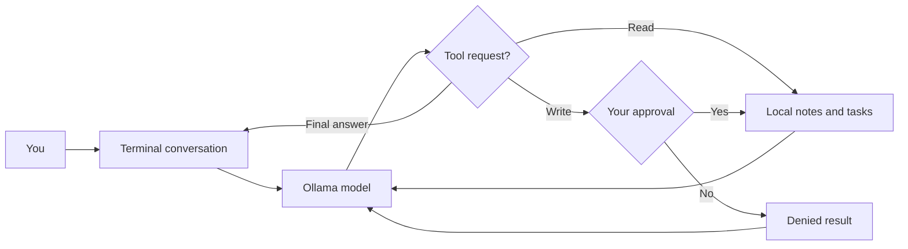

# Pocket Agent

**A small personal AI assistant that remembers notes, manages tasks, and asks before making changes.**

[](https://github.com/Skeeb32/pocket-agent/actions/workflows/ci.yml)

[](LICENSE)

Pocket Agent turns a conversation into useful actions through a bounded tool-calling loop. Its first release focuses on a simple daily workflow: capture a note, add a task, and find out what is still open. It runs in your terminal, stores data on your computer, and uses a local model through Ollama.

An original, independent project inspired by the personal-assistant category popularized by [OpenClaw](https://github.com/openclaw/openclaw). This is not an OpenClaw fork, integration, or replacement; no OpenClaw source code is included.

## Try it in 30 seconds

Requires **Node.js 22 or later** and Git. There are no npm dependencies to install.

```sh
git clone https://github.com/Skeeb32/pocket-agent.git
cd pocket-agent
npm run demo
```

```text
Pocket Agent demo — scripted model, temporary data, no network.
  tool → add_task
  tool → list_tasks
Created your task: Try Pocket Agent. It is not completed yet.
```

The demo exercises real tools and temporary storage with scripted model responses. It does **not** demonstrate live AI inference. Its temporary data is removed when it exits.

## Run the real agent

1. Install [Ollama](https://ollama.com/download) and start its local server (open the desktop app, or run `ollama serve` in another terminal).
2. Download a model that supports tool calling:

   ```sh
   ollama pull qwen3:8b
   ```

3. Start Pocket Agent:

   ```sh
   npm start
   ```

Try these prompts:

- “Remember that I prefer morning meetings.”
- “Add a task to review my portfolio.”
- “What tasks are still open?”
- “Mark the portfolio review task complete.”
- “What have I asked you to remember?”

Every write displays the exact tool name and arguments. Type `y` to approve; any other answer declines. Task completion uses the stored task ID, which the agent can obtain with `list_tasks`. Enter `/exit` to quit.

Model downloads require disk space and sufficient memory; inference speed and tool reliability depend on your hardware and chosen model. Pocket Agent itself requires no API key or paid account when using a local model.

## What works today

| Capability | Behavior |
| --- | --- |
| Conversational assistant | Uses Ollama's chat API with tool definitions |
| Persistent notes | Saves and lists notes across restarts |
| Task management | Adds, lists, and completes tasks |
| Human approval | Prompts before every persistent change |
| Visible actions | Prints each tool name as it runs |
| Bounded execution | Stops after eight model steps per user request |
| Offline demo | Runs without Ollama or network access |
| Tests and CI | Tests storage, approval, tool errors, limits, and the provider contract |

## How it works



The model proposes calls, while application code validates and executes them. Tool results return to the model before it answers. The allowlist contains exactly five tools: `list_notes`, `save_note`, `list_tasks`, `add_task`, and `complete_task`.

```text
src/
  cli.js       Interactive conversation, approval prompts, offline demo
  agent.js     Model adapter and bounded agent loop
  tools.js     Tool schemas, argument validation, approved execution
  store.js     JSON persistence with atomic file replacement
test/
  agent.test.js
```

## Configuration

Defaults work with a standard local Ollama installation. To customize them, copy `.env.example` to `.env` and edit the values. `npm start` loads `.env`; existing environment variables take precedence.

| Variable | Default | Purpose |
| --- | --- | --- |
| `OLLAMA_HOST` | `http://127.0.0.1:11434` | Ollama server URL |
| `OLLAMA_MODEL` | `qwen3:8b` | Installed tool-capable model |
| `POCKET_DATA_DIR` | `.pocket-agent` | Data directory, relative to the working directory |

Each model request has a 120-second timeout. A request can make up to eight model calls, with at most sixteen tools per call. These are execution bounds, not a guarantee of task completion.

## Data and trust

- Notes and tasks live in `.pocket-agent/state.json`. This directory and `.env` are ignored by Git.
- Conversation history stays in memory for the current session; it is not saved across restarts.
- A local Ollama model keeps inference on your machine. If you configure a remote server or cloud-backed model, prompts and retrieved notes/tasks are sent there.
- Stored data is plain JSON, not encrypted. Do not use this prototype as a secrets vault.
- The agent cannot run shell commands, browse websites, send messages, or read arbitrary files. Its tools access only its own state file.
- Model output and saved notes can be wrong or adversarial. Approval is enforced in application code; review proposed changes before accepting.
- Run one process per data directory. Atomic replacement protects against partial files, but concurrent writers are not supported.

## Development

```sh
npm test
npm run demo
```

Tests use temporary directories and mocked model responses. They do not require Ollama. CI runs on Node.js 22 and 24. Live inference must be checked separately with an installed model; passing tests do not establish model quality.

To add a tool, define its schema in `src/tools.js`, validate its arguments, implement its action, and add behavioral tests. Keep the approval check in front of every write or external side effect.

See [CONTRIBUTING.md](CONTRIBUTING.md) for contribution guidelines and [SECURITY.md](SECURITY.md) for reporting security problems.

## Troubleshooting

| Problem | Next step |
| --- | --- |
| Connection error / fetch failed | Start Ollama and check `OLLAMA_HOST` |
| HTTP 404 | Run `ollama pull qwen3:8b`, or match `OLLAMA_MODEL` to an installed model |
| Model answers without tools | Use a tool-capable model and request a specific supported action |
| Timeout | Try a smaller compatible model or check the Ollama server |
| Step limit reached | Check saved tasks before retrying; approved actions may already have completed |
| Invalid state file | Back up `state.json` and repair its JSON; the agent will not silently overwrite it |
| Writes are declined in a pipeline | Run interactively; non-interactive writes are denied |

## Scope and roadmap

This is an early, single-user CLI release. It does not currently include web search, chat-app integrations, scheduled reminders, conversation persistence, multi-user access, or a web interface.

- [x] Local tool-calling agent
- [x] Persistent notes and tasks
- [x] Human-approved changes
- [x] Offline demo and automated tests
- [ ] Search and edit existing notes
- [ ] Export and import user data
- [ ] Optional conversation persistence
- [ ] Additional model providers
- [ ] Scheduled reminders with explicit opt-in

Roadmap items are planned ideas, not available features.

## Credits and license

Built by [Skeeb32](https://github.com/Skeeb32). MIT licensed; see [LICENSE](LICENSE).

References: [Ollama tool calling](https://docs.ollama.com/capabilities/tool-calling), [Ollama chat API](https://docs.ollama.com/api/chat), and [OpenClaw](https://github.com/openclaw/openclaw).
